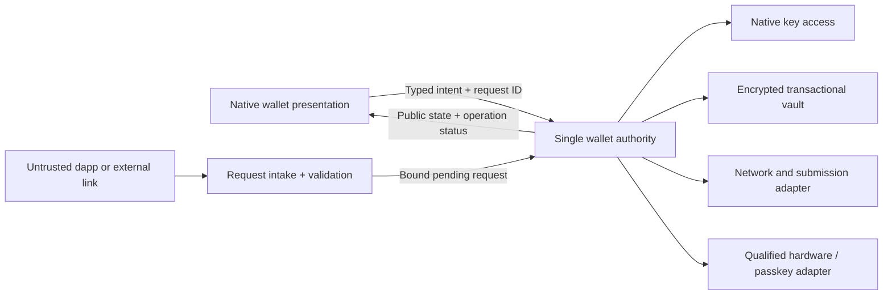
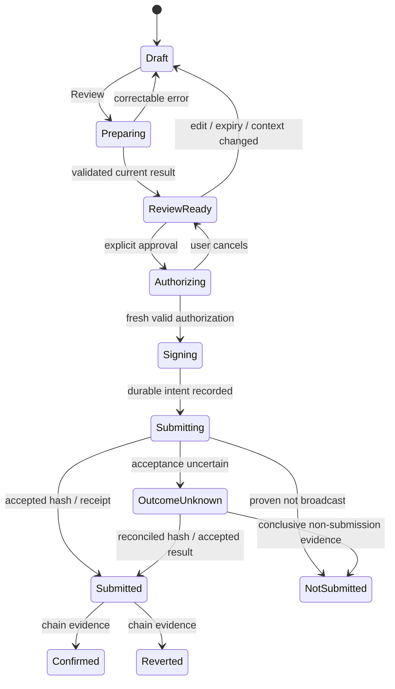

# Pali mobile: security-sensitive journeys

Design baseline: extension wallet source `4470e54e8777cca2a4fe7c712409f60eeb4fa401` (4.0.120), checked locally on November 2, 2026. This document defines the target experience and acceptance criteria for feature equivalence with that extension. It is not a description of completed native custody or a cryptographic implementation.

The current native development flow implements wallet creation/import, password unlock, seed backup, multiple seed-derived Ethereum accounts (create/select/rename/remove/restore), and per-account ETH portfolio, receive and send operations with an encrypted transaction journal. Public-address watch-only accounts and the sample-data preview remain separate modes. Dapp connections, hardware/passkey signing and the broader target below are not enabled by that native flow. Full feature equivalence remains incomplete. An end-to-end native testnet transfer, physical-device behavior and signed release artifacts remain unqualified; unavailable capabilities must remain explicit.

Source references in this document are relative to the repository root. Existing behavior is labelled **Source**; new mobile behavior is labelled **Target**. The [engineering handoff](/Users/sidhujag/.codex/visualizations/2026/10/17/01a14a52-2ce3-7b32-9862-b1e9391eb945/pali-mobile-wallet-handoff-2026-11-02.md) is additional context, not independent validation of native behavior.

## 1. Authority and identity shared by every journey

**Source.** The extension separates its app, external approvals, background authority, and injected dapp provider. Its wallet controller has independent session, wallet-state, and network-request generations. Its startup code distinguishes a failed read from an absent wallet and reconciles recovery before migration. UI state is a projection of the authority, not permission to sign.

**Target.** One app-owned wallet authority owns custody, persistence and command admission. React Native renders a public projection and submits typed, narrowly defined operations. A dapp, deep link, QR payload, navigation route, copied address, balance cache, or Redux snapshot never becomes the authority.

Each sensitive operation binds to the wallet profile, account ID and account type, derivation identity, network kind and chain identifier, relevant endpoint identity, authority session generation, wallet-state generation, operation/request ID, and expiry. Include the source dapp/session identity when applicable. Returning from account A to B to A must not make A's old authorization valid again.

The authority invalidates outstanding authorization on lock, relevant account/network change, profile replacement, signer disconnect, expired review, failed migration, or changed request payload. It may preserve a nonsecret draft, but continuing always produces a new review of the current context. Network and account controls stay visibly separate.

**Storage rules.** Persist an encrypted candidate and required recovery metadata before publishing a successful mutation. A failed or ambiguous storage acknowledgement is reconciled by reading durable state; it is not permission to overwrite or delete. Small native protected credentials and a large encrypted transactional vault have different storage roles. Multi-megabyte private-note state does not go into one SecureStore value. OS restore, reinstall, key invalidation, backup exclusions, and old schema migration are part of the format design.

**Source anchors:** [controller generations](../../../source/scripts/Background/controllers/MainController.ts), [startup/recovery](../../../source/scripts/Background/handlers/handleMasterControllerInstance.ts), [presence check](../../../source/scripts/Background/utils/readWalletPresence.ts), [commit-before-publication](../../../source/state/store.ts), [storage adapter](../../../source/utils/storageAPI.ts).

## 2. Cold start and lock

| State                          | User sees and can do                                                  | Authority and interruption behavior                                                                                     |
| ------------------------------ | --------------------------------------------------------------------- | ----------------------------------------------------------------------------------------------------------------------- |
| Opening                        | Pali identity and a short progress state; no fabricated zero balance  | Read durable records and journal; do not start account-sensitive work until context is known.                           |
| No wallet                      | Create wallet, restore wallet, connect hardware, or watch an address  | Show only when absence is positively established. Watching an address remains a separate non-custodial mode.            |
| Stored wallet, locked          | Account-neutral lock screen and the supported unlock methods          | Keep account balances, request details and secret views hidden. A displayed unlocked flag cannot resume an old session. |
| Recovery/migration pending     | A specific restoration progress state; Retry or Help if it fails      | Reconcile prior commit before migration and unlock. Never offer a fresh-wallet overwrite as the error fallback.         |
| Storage unavailable/incomplete | “Your wallet data could not be read. Nothing has been replaced.”      | Retry read-only. No automatic reset, empty-wallet screen, or misleading “wallet not found.”                             |
| Unlocked                       | Current account and network, balance state, pending operation notices | Resume only current-context reads. Reconcile possible submissions before offering another send.                         |

**Target unlock.** Keep the extension's strong wallet-password route as the portable recovery path. Native biometric unlock is an optional convenience after a successful password unlock and explicit enrolment. It gates an established protected credential; it is not the wallet backup. A six-digit app PIN must not silently replace the vault password or become its sole offline KDF input. If an app PIN is later offered, its native rate limiting and fallback require a separate reviewed contract.

Biometric cancellation returns to locked. Credential invalidation offers password unlock and reenrolment, without deleting the vault. Failed attempts follow persisted throttling; foregrounding, reinstalling a view, or changing a route must not reset throttling. An authentication prompt and its app-state transitions need a purpose-specific flow, not a blanket exemption that keeps the wallet unlocked.

**Background policy.** Cover sensitive content immediately for the OS task switcher; suspend interactive authorization and invalidate secret-view grants. Record foreground/background transitions in the authority, not only in a React effect. On resume, recompute elapsed lock policy from a trusted clock and reread operation status. Default to locking when backgrounded for the first custody release; a later configurable grace period requires a documented device-tested policy. Timers are not assumed to run while suspended.

**Source anchors:** [unlock and throttling](../../../source/scripts/Background/controllers/MainController.ts), [onboarding secret lifetime](../../../source/hooks/useOnboardingSecrets.tsx), [controller status](../../../source/hooks/controllerStatus.ts).

## 3. Create a wallet

**Target path:** Welcome -> Create wallet -> Create password -> Recovery explanation -> Secure phrase display -> Backup verification or explicit defer -> Durable completion -> Wallet.

1. The authority first verifies that no wallet exists and no recovery/migration is pending. Creation is single-flight across all views; an old completion cannot replace a newer profile or unlock after backgrounding.
2. Reuse the extension/keyring's validated entropy, mnemonic and vault protocol through a qualified native runtime. The presentation never generates a seed, selects a fallback RNG, or receives raw keys through public state.
3. Explain the backup before revealing it: “These words restore your seed-derived accounts. Anyone who has them can use those funds.” Use a dedicated secret surface and one deliberate Reveal action.
4. Display numbered words in reading order with a readable size. No default copy, screenshot, share-sheet export, analytics, input history, or remote keyboard suggestion for the phrase. Screen-capture and task-switcher protection are native requirements with tested platform-specific limits; do not promise screenshot blocking on every OS.
5. Backup verification must check the user's recorded words without presenting a guessable success animation in place of a result. Label actual completion: “Recovery phrase verified.” If skipping is allowed, retain an unambiguous “Backup not verified” state; never mark a seed verified because the user tapped “I saved it.”
6. Creation is complete only after the vault and required public state are durably committed. If commitment succeeds after the user leaves/backgrounds, leave the resulting wallet locked. If commitment is uncertain, reconcile it before creating again. Do not generate a new wallet automatically on retry.

If the app is interrupted before durable creation, discard transient password/phrase material and restart safely. If the vault is already durable but backup verification is incomplete, reopen locked with a backup reminder. The user must be able to reveal that existing wallet's phrase after fresh authentication; never replace it with a newly generated phrase.

**Safety copy at the relevant point:** “Pali support will never ask for these words.” Avoid claims that a seed restores imported keys, passkeys or private notes.

## 4. Restore, import and local access recovery

These are three distinct journeys and must not share an ambiguous “Recover” button.

| Journey                                     | Target states                                                                                                                                        | Required distinction                                                                                           |
| ------------------------------------------- | ---------------------------------------------------------------------------------------------------------------------------------------------------- | -------------------------------------------------------------------------------------------------------------- |
| Restore on a new installation               | Choose recovery type -> phrase/private-key input -> local validation -> derived public identity review -> password -> durable commit -> locked/ready | Recreates what that credential can derive. Phrase entry never uses a generic dapp or remote web form.          |
| Add an account to an existing wallet        | Choose account type -> authenticate if required -> validate/import -> review public identity -> durable commit -> account list                       | Adds an account. It does not reset existing wallets or switch account types silently.                          |
| Recover access to the existing local wallet | Locked -> explain recovery scope -> admit a short-lived recovery request -> enter matching phrase -> new password -> recover journal -> complete     | Must prove the phrase matches the locked durable wallet identity. It cannot become arbitrary-seed replacement. |

**Source.** `walletRecovery.ts` admits a time-limited ticket bound to the encrypted durable pair, generations and selected HD identity. It validates the phrase against the saved account, journals the previous state and reconciles ambiguous writes. Ordinary onboarding refuses an existing wallet.

**Target.** Preserve that protocol behind the native storage port. A biometric reset or forgotten app PIN does not bypass wallet authentication. A phrase that does not match the local wallet gives “This phrase does not match this wallet” without overwriting it. Offer the separate, explicitly destructive removal flow if the user intends to replace the wallet.

For import input, disable suggestions, autofill and autocorrect; do not persist text in navigation or application state. Paste may be deliberate but must not auto-read the clipboard. Use local validation and sanitized errors that do not echo words or private keys. The public identity review shows complete addresses, account kind, derivation scheme where meaningful, and applicable networks. An account name/logo is never proof of ownership.

**Interruption:** backgrounding clears the transient entry and admission; an OS authentication cancellation returns to the prior safe screen. A persisted recovery journal resumes reconciliation before another attempt. A successful-but-unacknowledged commit is verified, not “rolled back” by deleting its new vault.

**Source anchors:** [recovery protocol and journal](../../../source/scripts/Background/controllers/walletRecovery.ts), [presence/atomic creation tests](../../../source/scripts/Background/utils/readWalletPresence.atomicCreation.spec.ts), [transient onboarding state](../../../source/hooks/useOnboardingSecrets.tsx), [import routes](../../../source/routers/index.tsx).

## 5. Backup, secret reveal and removal

### Backup and supported secret handling

Separate the following entries in Security and recovery. Each gives its scope before opening the secret surface.

| Item                      | Scope and confirmation                                                                                                                                                                                                                      |
| ------------------------- | ------------------------------------------------------------------------------------------------------------------------------------------------------------------------------------------------------------------------------------------- |
| Recovery phrase           | Seed-derived accounts only. Fresh password authorization before revealing; numbered phrase and verification state.                                                                                                                          |
| Imported private key      | That imported account only. Identify the exact account/network before fresh password authorization.                                                                                                                                         |
| Private note backup       | One raw note at a time: select the note, confirm the password, display its read-only raw text, then Hide. The current dialog provides no Copy, Download or Share action. A note is bearer recovery material independent of the wallet seed. |
| Hardware/passkey recovery | Link to the credential's own recovery model. Never imply the Pali phrase regenerates a hardware seed or an OS-synced passkey.                                                                                                               |

Sensitive reveal or supported export authorization is purpose-bound, short-lived and consumed once. Unlocking the app earlier is not sufficient. Secret content is absent from public snapshots, logs, telemetry, deep links, toasts and error messages. Screen readers can intentionally read the dedicated secret surface; decorative elements and hidden background screens cannot reveal it.

**Source parity boundary.** The encrypted private-vault records, shards and bundle budgets are internal persistence structures, not a user-facing encrypted backup file. No encrypted vault/bundle export or bundle-import journey is included in this parity design. Adding one would be separate product and cryptographic format work. The current private-note backup dialog reveals a selected raw note only after password confirmation; it neither copies automatically nor offers a download/share button. The mobile counterpart preserves that behavior rather than adding an OS share sheet to this flow. Any source-supported secret-copy action elsewhere remains deliberate and warns about external retention; it cannot prove the user has a readable backup merely because a copy succeeded.

### Remove from this phone

**Target path:** Account/wallet settings -> choose exact scope -> show consequences and backup inventory -> fresh authorization -> final destructive confirmation -> committed deletion -> Welcome or remaining account.

Removing one watch-only entry, removing one imported account and forgetting the entire wallet are different actions. The final sheet names the affected profile and lists recoverability consequences. For the full wallet, include all associated SLIP-44 vaults, imported keys, private notes, local passkey records, cached proofs and pending operation records in the deletion inventory. State external effects that removal cannot perform: it cannot reverse a transfer, revoke on-chain permissions, delete an external passkey, or erase copies the user has made outside the app.

A zero or unavailable balance is not evidence that removal is safe. Present incomplete backup and unresolved-operation warnings without inventing a “no funds remain” guarantee. Private-note loss must not be buried under seed-only wording. Keep authentication separate from the final “Remove wallet from this phone” action. After confirmation, invalidate sessions before deleting; complete/reconcile the durable deletion before showing a clean installation. A failed delete says “Removal could not be completed” and preserves a retry path instead of leaving mixed records that appear empty.

## 6. Transfers: prepare, review, authorize, reconcile

The target state model applies to EVM native/token/NFT sends, UTXO/PSBT sends, smart-account execution and dapp transaction requests. Chain-specific builders and validators remain different.

“Signed” is not “sent”; “submitted” is not “confirmed”; a reverted on-chain transaction may still have paid a fee. User rejection before signing is not a network failure. The authority, not a UI timeout, classifies these outcomes.

### Draft and preparation

- Bind the draft to profile/account type/network/asset identity. Preserve only permitted nonsecret fields. Do not carry a recipient or amount silently into another network.
- Validate exact integer quantities and token precision. A missing balance, failed price quote or loading fee is not zero. An unavailable fiat conversion must not disable correct native-amount review or invent a dollar value.
- Treat address resolution, token metadata, fee quotes, gas simulation, UTXO selection and nonce reads as context-bound asynchronous work. Discard stale A -> B -> A results. Name resolution shows both the name and resolved address; require renewed review if the resolution changes.
- Asset identity is network plus contract address/token ID or Syscoin asset GUID, not ticker/logo. Distinguish native SYS, SYS assets and EVM representations. Metadata and spam status cannot authorize transfers.
- Preparation does not sign. The authority returns an immutable review model and opaque review handle with expiry. Editing any material field invalidates it.

### Review screen

Keep the primary account/network context visible at every scroll position. Show the full recipient with an intentional expansion/copy control; do not rely only on a shortened address. Show the native amount, asset identity, estimated fee and maximum authorized fee/debit, and explicitly mark unavailable estimates. For EVM contract calls, show known decoded effects plus raw data access and honest unknown-effect warnings. A successful simulation is evidence from a point-in-time model, not a guarantee of safety or final execution.

For UTXO sends, identify recipients, selected assets, fee, change and any consolidation/burn behavior. Preserve PSBT metadata needed for review and distinguish partially signed from ready-to-broadcast results. Pali's provider contract uses structured `{ psbt, assets }` for `sys_sign`; returned metadata limitations must remain visible to the caller.

For NFT sends, show contract/GUID, token ID, quantity and ownership validation. For approvals, show spender/operator, scope and limits; a token approval is not a transfer of the same displayed amount. Avoid generic “Confirm transaction” copy when a precise action label is available.

### Authorization and submission

Freshly check review identity and expiry after password/biometric/device confirmation returns. The auth callback cannot navigate or sign if the app moved, locked or changed context in the meantime. Purpose-bound authorization cannot approve another queued request. Never automatically retry signing or broadcasting after a transport timeout.

Record the accepted intent/reservation and minimum reconciliation data durably before entering the external submission boundary. Do not store raw secret material for resumption. A signature returned to a dapp or hardware transport can have external effects even if the app loses its local acknowledgement.

For a known-not-broadcast failure: “Nothing was sent. Review again to retry.” For uncertainty: “We could not confirm whether this transaction was submitted. Pali is checking its status. Do not send it again yet.” Offer Check status and the independently known transaction identifier when available. Do not display a resubmit CTA until chain-specific reconciliation permits it. Process death during submission reopens this status, not the old Confirm button.

Replacement/cancellation flows get their own review of the authenticated original transaction, replacement fields and fee bounds. They cannot silently become a second independent payment. EOA `wallet_sendCalls` runs sequentially; show which calls were submitted and which were not. Only claim atomicity for a supported smart-account batch after checking that account's active-chain capability.

**Source anchors:** [send preparation lifetime](../../../source/pages/Send/useSendDraftWriter.ts), [EVM send](../../../source/pages/Send/SendEth.tsx), [UTXO send](../../../source/pages/Send/SendSys.tsx), [review and confirmation](../../../source/pages/Send/SendTransaction.tsx), [approval submission boundary](../../../source/scripts/Background/handlers/approvalSubmission.ts), [private withdrawal's explicit unknown outcome](../../../source/scripts/Background/controllers/privacyWithdrawals.ts), [bundle identity and status](../../../source/scripts/Background/controllers/message-handler/sendCallsBundles.ts).

The private-withdrawal implementation is a useful source for uncertainty handling. Its presence does not establish that all current extension send paths already implement the generalized target state machine above.

## 7. External requests and connected apps

**Target intake:** OS/deep-link/QR transport -> bounded parse -> establish peer/request identity -> enqueue -> user opens the request -> select disclosed account/network -> review requested action -> explicit authorize/reject -> correlated response.

A link may request an action but cannot select a privileged route, execute a controller path, restore a seed, install a network silently or authorize a transfer. Keep third-party browsing content out of the wallet's privileged JS and native bridge. There is no public `invoke(methodPath,args)` surface.

The coordinator binds each request to transport session, authenticated/verified origin evidence where available, request ID, payload digest, requested accounts/networks, wallet session and expiry. Display verified transport information separately from peer-supplied names, URLs and icons. WalletConnect metadata alone is not proof of domain ownership. If identity cannot be verified, say so without inventing a green trust badge.

- **Connect:** show requested public accounts, networks and permissions. “Connect” gives that scope only; it never approves a future transaction. Offer Reject with equal reachability.
- **Switch/add network:** show chain ID, network kind, endpoints and mismatch warnings. Validate endpoint network identity before saving; an untrusted proposal is not an authenticated registry entry.
- **Messages:** identify the requesting app and signing account. Render plain/personal, typed-data, SIWE, order, approval and transaction requests according to their semantics. Show domain/chain/nonce/expiry and recovered effects where applicable; unknown content stays unknown. Do not advertise message signing as inherently harmless.
- **Queue:** one foreground authorization at a time; bounded pending count and per-peer limits. Duplicates return the original status instead of executing again. Locking, disconnecting, expiry or rejected permissions terminate the right request; an old result cannot respond to a newer request with a reused visible ID.
- **Connected apps:** list actual grants with accounts/networks and last activity, allow scoped revocation, and explain that revoking a session does not revoke on-chain token approvals. Do not imply closing the app cancels requests already accepted on-chain.

**Source anchors:** [trusted sender boundary](../../../source/scripts/Background/handlers/internalMessageAuthorization.ts), [external request registry/pipeline](../../../source/scripts/Background/controllers/message-handler), [approval client](../../../source/utils/approvalClient.ts), [routes](../../../source/routers/index.tsx).

## 8. Hardware, passkeys and smart accounts

### Hardware accounts

**Target states:** choose device -> supported transport -> discover/pair -> verify model, firmware and authenticity -> choose derivation/account -> confirm address on device -> save public account -> connected/disconnected status.

Support is a tested matrix of device model, firmware, OS, transport, network and operation. Do not list a connected brand as proof that every signing method works. Existing extension Trezor and Ledger routes are browser integrations; native USB/BLE and Safe 7 pairing/attestation are separate work. Device authenticity checks need current host libraries, not just a model-name match. Any advisory-based firmware minimum is rechecked against current vendor fixes before implementation/release.

Pali receives only the required public account data. Recovery words and device PIN stay on the hardware wherever the qualified device flow supports that behavior. Show device name and expected account/network on the app while the user checks the complete receiving address or transaction on the device. A rejected or disconnected device returns to review/connection state, not to software signing. Changing the device or derivation path invalidates the pending review. No automatic fallback to a software key.

**Source anchor:** [hardware account import](../../../source/pages/Settings/ConnectHardwareWallet.tsx).

### Passkeys

Passkey setup, smart-account creation and biometric unlock are different concepts. Present the selected credential provider, user verification, device-bound/synced/unknown backup status, and recovery consequences truthfully. Never say that an app's recovery phrase restores a passkey, or that an OS passkey is guaranteed available on another phone.

Native assertions must preserve the existing challenge, credential, public key, RP-ID hash and origin binding. Associated-domain and native-origin semantics require an explicit compatible validator design; removing browser checks is not a port. A credential prompt that returns after lock/profile/network change is discarded. Enrollment is not complete until the intended on-chain validator/account and durable local reference are confirmed. Cancellation leaves the previous signer intact.

**Source anchors:** [WebAuthn client-data validation](../../../source/utils/passkey/validation.ts), [credential/public-key/RP binding](../../../source/utils/passkey/authenticator.ts), [browser authenticator implementation](../../../source/utils/passkey/webauthn.ts).

### Smart accounts, governance and advanced signers

Show EOA versus smart-account identity explicitly. Deployment, owner/validator changes, modules, spending policy, recovery delay, gas payer and relayer are substantive actions with their own reviews. Do not conflate a successful signature with deployment, a recovery request with completed recovery, or a sponsored fee quote with a guaranteed free transaction.

**Guardian recovery is separate from composite signing.** The current extension setup/recovery UI supports one guardian with threshold 1: installation encodes `guardians: [address]` and `threshold: 1`, and the recovery request flow rejects a different guardian count/threshold. The mobile parity flow must show that one guardian, the configured delay/expiry, and Pending/Cancelable/Executable/Completed recovery states based on verified on-chain time. It must not advertise a 2-of-3 guardian recovery policy.

**Composite signing** selects child validator methods and a supported approval threshold, including 2-of-3 when three valid, compatible methods are selected. Show “2 of 3 selected methods must approve” for that signing policy, with each method's actual availability. This is an authorization policy for signing, not the number of guardian approvals needed to recover an account. Preserve the existing rejection of invalid/duplicate methods and policies that cannot obtain enough supported local approvals.

The Syscoin Sentry flows are wallet/governance operations, not a crash-reporting SDK. Their collateral, key, registration and voting changes use the same context and outcome rules. Preserve their distinct chain requirements.

SLH-DSA setup/signing needs native isolated compute, pinned assets, progress, resource budgets, cancellation and durable usage/rotation state. Keep the source parameter set and limits unless separately reviewed. Do not label all wallet activity post-quantum because one signer or device feature uses a PQ algorithm.

**Source anchors:** [single-guardian setup/recovery UI](../../../source/pages/Settings/SmartAccountPolicy.tsx), [composite signing dialog](../../../source/pages/SmartAccount/CompositeApprovalDialog.tsx), [composite signing tests](../../../source/pages/SmartAccount/CompositeApprovalDialog.spec.tsx), [smart-account controllers](../../../source/scripts/Background/controllers/smartAccount), [Sentry settings](../../../source/pages/Settings/SentryKeys.tsx), [SLH-DSA parameters/limits](../../../source/utils/slhDsa/constants.ts), [offscreen execution boundary](../../../source/utils/slhDsa/offscreenClient.ts).

## 9. Private notes and proving

Private notes are bearer secrets independent of seed-derived account keys. A phone reset, account deletion, seed restore or capacity change must not silently discard them. Showing a note in Activity is not a backup.

| Journey           | Target states and durable boundary                                                                                                                                                                           | Interruption / essential copy                                                                                                                                                                                                                    |
| ----------------- | ------------------------------------------------------------------------------------------------------------------------------------------------------------------------------------------------------------ | ------------------------------------------------------------------------------------------------------------------------------------------------------------------------------------------------------------------------------------------------ |
| Deposit           | Select supported pool/account -> prepare and durably retain the note -> review deposit -> Back up note (password-gated reveal) -> acknowledge backup requirement -> authorize -> submit -> reconcile funding | The acknowledgement states that the user understands the backup requirement; it is not proof of a completed backup. After uncertain broadcast, retain the same note and check funding state; never generate a replacement as an automatic retry. |
| Import note       | Enter one raw note string -> local parse -> identify pool/commitment -> verify public status -> store internally encrypted -> display current status                                                         | This input accepts the raw note, not an encrypted vault/bundle file. Pending verification is distinct from invalid/not found. Duplicate imports return the existing note. A successful save is retained even if its public status changes.       |
| Withdraw          | Choose funded/eligible note -> recipient/relayer/fee review -> local proof -> final current-context authorization -> durable reservation -> submit -> reconcile                                              | “Proof complete” does not mean “withdrawal sent.” Unknown outcome keeps the reservation; no duplicate withdrawal retry.                                                                                                                          |
| Reveal for backup | Choose one note -> show backup warning -> Confirm password -> read-only raw Private note -> Hide                                                                                                             | No app-provided Copy, Download or Share action. Hide, background, lock, context change or selecting another note removes plaintext; a delayed reveal result is discarded. Reopening requires a fresh password confirmation.                      |
| Capacity/cleanup  | Show count, supported capacity and storage budget -> validate eligibility -> explicit confirmation -> durable change                                                                                         | Never reduce below stored count. Only explicitly eligible completed notes can be cleared. Seed backup does not make note deletion reversible.                                                                                                    |

The shared engine uses one canonical, sharded internal note format for every saved inventory, including empty and small vaults. Its explicit format discriminator separates it from unsupported pre-release note layouts; those records are preserved and rejected, never silently converted or overwritten. This consolidation does not change released wallet credential formats, key derivation or the possibility of multiple retained key profiles.

The current source supports note capacities 128/256/512 and corresponding **internal encrypted-storage** bundle budgets 4/8/16 MiB. These are persistence/retention compatibility obligations, not user-facing export sizes or an encrypted file-import contract. They do not prove that all target phones can process the maximum efficiently. If a phone cannot prove with a large vault, retain its records and preserve the supported individual-note reveal/import route; disable only the unavailable operation. Do not truncate records to fit storage.

Source-aligned note backup copy is: “Save a private backup of this note. Generated notes cannot be restored from your recovery phrase.” The warning beneath the revealed note is: “Anyone with this note can withdraw. Keep your backup private.” Deposit acknowledgement is: “I understand that I need the note backup to withdraw.” Do not replace that acknowledgement with “Backup verified.”

Proof state is Prepared/Queued/Proving/Proof ready/Cancelled/Failed, followed by a separate submission state. Only public progress and safe status cross into UI state; witness inputs stay in the authority/compute boundary. Recheck artifact hashes and sizes, including cached artifacts, and preserve the source's job identity and deadline checks. Show meaningful progress and a Cancel action while explaining whether cancellation is still possible. Process death before submission restarts proof preparation from the retained encrypted note; it never reports a withdrawal failure merely because compute was interrupted.

Privacy service, Ethereum RPC and relayer are separate endpoints and trust relationships. Disclose the endpoint that receives a request at the moment it matters. Changing one is not described as changing all of them. Never promise network-level anonymity solely because a proof is zero knowledge.

**Source anchors:** [password-gated raw-note dialog](../../../source/pages/Privacy/PrivateNoteBackupDialog.tsx), [no copy/download and interruption tests](../../../source/pages/Privacy/PrivateNoteBackupDialog.spec.tsx), [raw-note import UI](../../../source/pages/Privacy/PrivateNotes.tsx), [deposit backup acknowledgement](../../../source/pages/Privacy/PrivateDeposit.tsx), [private-vault retention/import/reveal](../../../source/scripts/Background/controllers/privateVault.ts), [withdrawal reservations/outcomes](../../../source/scripts/Background/controllers/privacyWithdrawals.ts), [proof execution](../../../source/utils/privacy/prover.ts), [artifact verification](../../../source/utils/privacy/proverArtifacts.ts), [privacy pages](../../../source/pages/Privacy).

## 10. Data and platform boundaries

| Data or operation                                       | Target owner and treatment                                                                                                                                                                         |
| ------------------------------------------------------- | -------------------------------------------------------------------------------------------------------------------------------------------------------------------------------------------------- |
| Passwords, seed words, imported keys, decrypted notes   | Short-lived authority/secret surface only; no public snapshots, navigation persistence, telemetry or logs. Native cleanup is best-effort and must not be marketed as provable JS memory erasure.   |
| Native unlock credential / wrapping material            | Platform-protected access with explicit invalidation and backup policy; not a multi-MiB vault or a replacement for independent recovery.                                                           |
| Encrypted vault, notes, journals and signer usage state | Versioned transactional file/database; durable commit/recovery, bounded decoding/migration and no silent truncation.                                                                               |
| Public accounts, balances and transaction status        | Public projections, still privacy-sensitive. Separate real state from fixture data; explicit provider disclosure; cache scope includes endpoint and session context.                               |
| Supported secret-copy actions and clipboard             | Explicit user action; no automatic clipboard reads. Explain external retention. Private-note backup has no app-provided copy/download/share action. Do not erase unrelated user clipboard content. |
| OS lifecycle, camera, sharing, hardware transport       | Narrow native adapters. Request a permission only in the relevant feature; deny/cancel returns to a useful safe state.                                                                             |
| Untrusted metadata and dapp content                     | Bounded parse/render, no executable HTML or shared privileged web context, no arbitrary native method bridge.                                                                                      |
| Analytics/crash reporting                               | No new default SDK or secret-bearing reports. Any future data collection requires a separate product/privacy decision and data inventory.                                                          |

## 11. Acceptance and release evidence

Feature equivalence means implemented behavior and retained data for the source capability inventory, not matching the number of screenshots. A limitation can be staged explicitly while building; it cannot be labelled complete parity.

Required evidence before enabling each custody capability:

1. **Shared logic:** existing relevant extension invariants and vectors run against the extracted implementation. No new UI-side signing authority or weakened crypto fallback; exact source/dependency pins recorded.
2. **Storage:** atomic creation, all-or-nothing migration/recovery, failed read, partial record, rejected write/delete, successful-but-lost acknowledgement, process kill between journal phases, concurrent account operations and capacity limits. Existing records survive every failed attempt.
3. **Lifecycle:** background/foreground, OS kill/relaunch, device lock, interrupted biometric prompt, stale authorization callback, clock/deadline change and A -> B -> A account/network races. No late completion reveals secrets or unlocks another context.
4. **Recovery:** correct/wrong phrase against an existing vault, imported-key distinction, backup verification, secret-view cancellation, supported recovery/private-key/raw-note formats, note/passkey exclusions and complete removal inventory.
5. **Transfers:** native/token/NFT, EVM and UTXO independently; all review fields, exact precision, changed fees/nonce/UTXO, insufficient/unknown balance, rejected device, rejected signature, known-not-broadcast and unknown broadcast with restart reconciliation. No automatic duplicate send.
6. **External requests:** transport identity spoofing, malicious metadata, payload limits, replay/duplicate IDs, queue expiry, disconnected peers, changing grants, unsupported methods, and stale results. Approval applies to exactly the reviewed request.
7. **Hardware/passkeys:** real supported devices on each OS/transport and current firmware; receive address verification, transaction confirmation, rejected/mismatched device, pairing/attestation failures, credential deletion/sync/invalidation, RP/origin mismatch and native associated-domain behavior.
8. **Private operations:** note import/duplicate/funding/spent states, maximum vault retention, pinned/corrupt proof artifact, low-memory compute, cancellation at every phase, interrupted deposit/withdrawal, password-gated raw-note reveal with no app copy/download action, and recovery by importing the separately backed-up raw note.
9. **Accessibility and privacy:** VoiceOver/TalkBack, large text, keyboard overlap, landscape/tablet, touch targets, modal focus, screen-capture/task-switcher behavior and intentional secret reading on real devices. The interface must not claim guarantees unsupported by that platform.
10. **Performance and network:** lowest supported hardware, cold unlock/KDF latency, storage size, proof memory, long lists, actual HTTP/RPC operation counts, offline/slow endpoints and battery impact. Device measurements, not desktop timings, set budgets.

Retain a per-capability evidence record: exact code/dependency/firmware versions, device/OS/transport, scenario, observed result and unresolved limitations. Security review and store release approval are separate from a passing simulator or browser run. No mainnet qualification, new hardware compatibility or production safety conclusion is implied by this design document.
