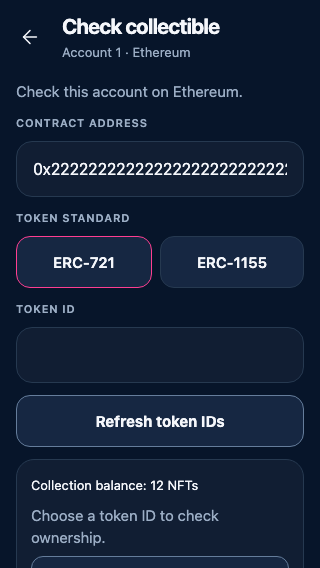
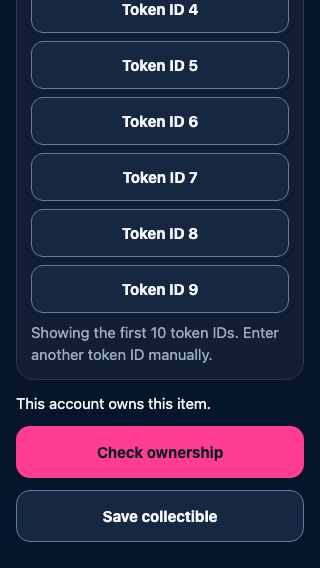
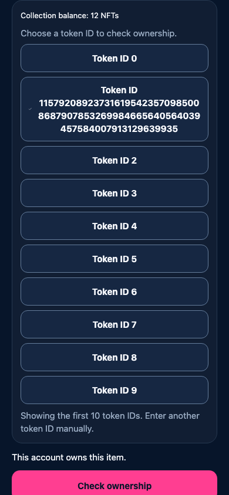

# ERC-721 collection lookup

Source: `1543eff47a78c90f5a3f3fa025cc49db16c4ef99`. [Frame provenance](manifest.json).

The collection balance is 12 NFTs; the first ten token IDs are shown. Selecting either ID 0 or the maximum uint256 ID runs the existing ownership check and retains the list. Nothing is saved or sent automatically. These are real React Native Web components using synthetic local RPC data, not device qualification. This additional capability has no direct screen in the original reference deck.

| Lookup at 320 px | Verified selection at 320 px |
| --- | --- |
|  |  |

