# Additional implemented screens

65 feature states; 130 fresh captures at 390×844 and 320×568.

UI source: a5a188be5e5114fc924b6596379142ea65c72a04. All frames use this source checkpoint; exact routes, timestamps and loaded asset URLs remain in manifest.json.

All captures render actual RNWeb components with synthetic public fixture adapters. No physical hardware, device biometric/camera/keyboard, live funds, or live network signing is represented. All external network access was blocked. The healthy market chart uses locally fulfilled, explicitly synthetic test responses. Development-only copy may be visible because these are development fixture exports.

## 01-watch-wallet — Watch-only account

Component: App / RealPortfolio.

Route: http://127.0.0.1:4292/?evm-activity=1&evm-activity-mode=value

Actions: View my accounts.

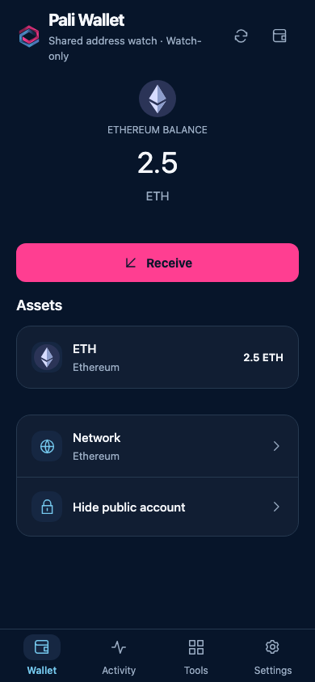

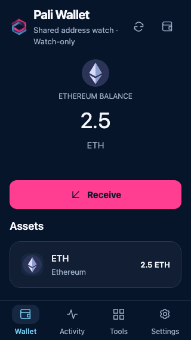

## 02-account-manager — Native account manager

Component: NativeAccounts.

Route: http://127.0.0.1:4291/?accounts=1

Actions: Initial state.

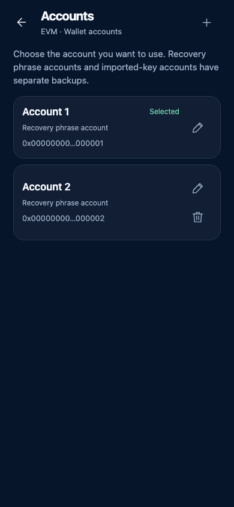

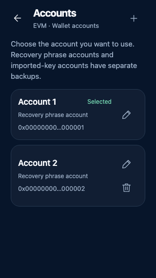

## 03-create-account — Create another software account

Component: NativeAccounts.

Route: http://127.0.0.1:4291/?accounts=1

Actions: Add account → Create account.

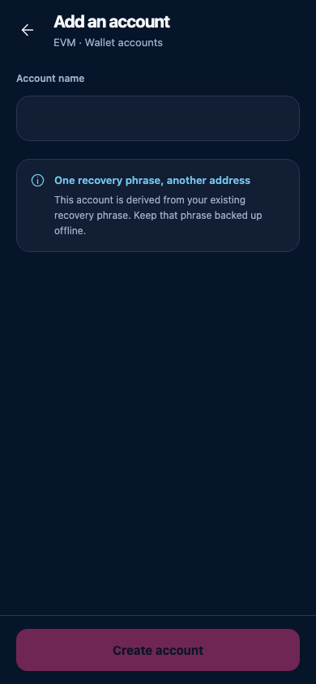

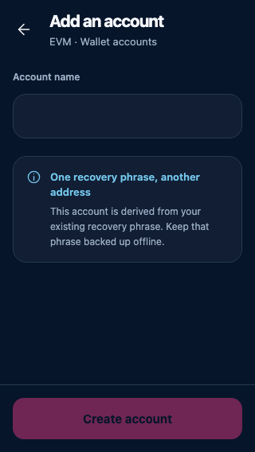

## 04-network-add — Add a custom network

Component: NativeNetworks.

Route: http://127.0.0.1:4291/?networks=1

Actions: Add network.

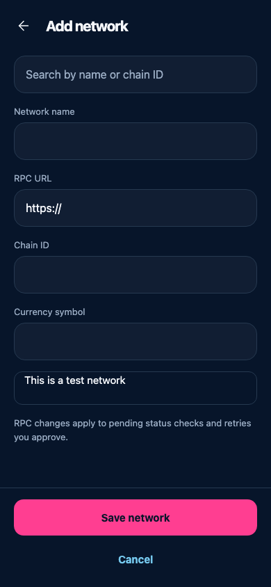

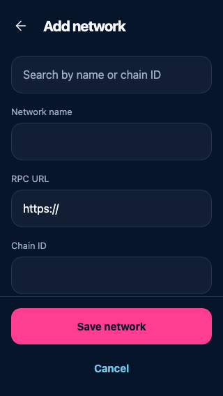

## 05-token-assets — Token assets

Component: NativePortfolio.

Route: http://127.0.0.1:4291/?token-portfolio&holdings

Actions: Initial state.

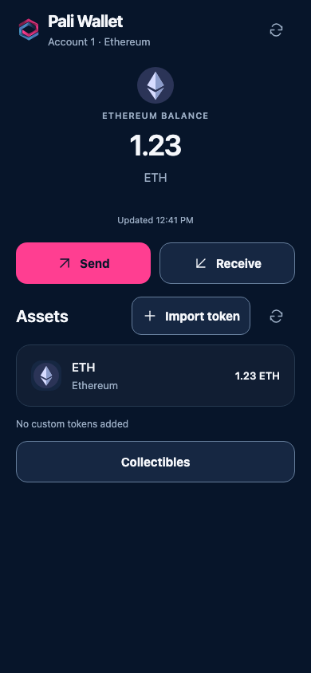

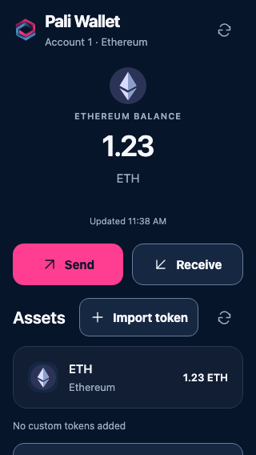

## 06-import-token — Import token / find holdings

Component: NativeTokens.

Route: http://127.0.0.1:4291/?token-portfolio&holdings

Actions: Import token → Find holdings.

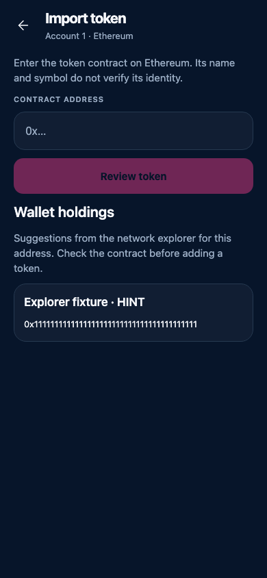

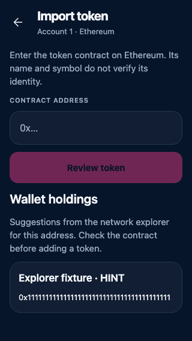

## 07-token-review — Verified token preview

Component: NativeTokens.

Route: http://127.0.0.1:4291/?token-portfolio&holdings

Actions: Import token → Enter public contract → Review token.

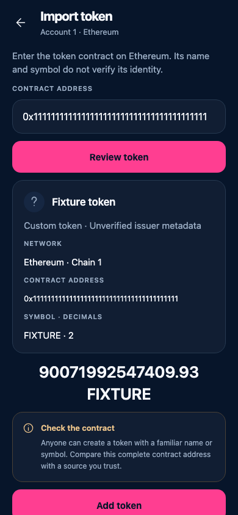

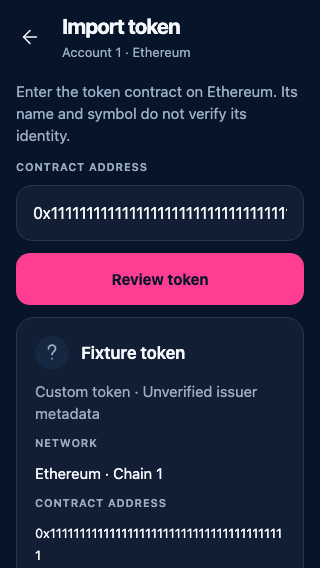

## 08-collectible-discovery — Collectible discovery

Component: NativeTokens.

Route: http://127.0.0.1:4291/?token-portfolio&holdings

Actions: Collectibles → Find collectibles.

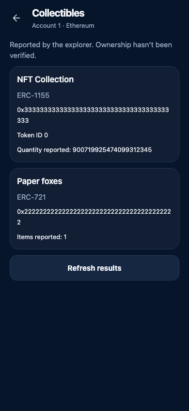

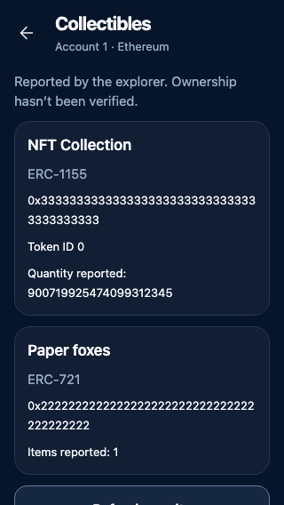

## 09-collectible-ownership — Collectible ownership form

Component: NativeTokens / CollectibleOwnership.

Route: http://127.0.0.1:4291/?token-portfolio&holdings&collectible-check

Actions: Collectibles → Check by contract.

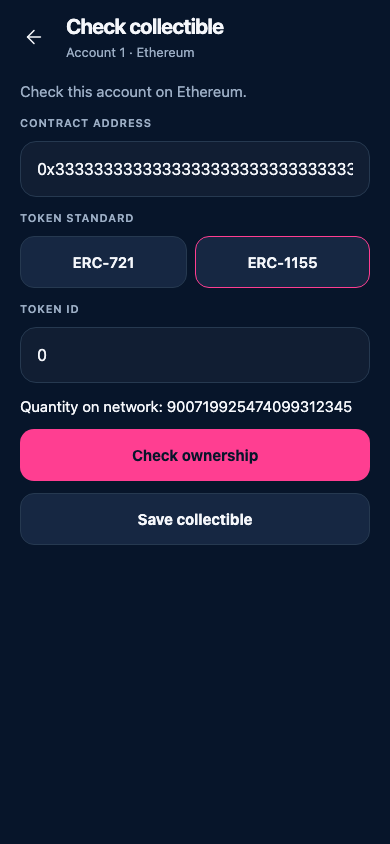

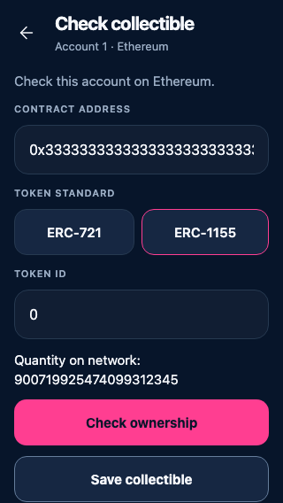

## 10-evm-nonce — EVM advanced nonce

Component: NativeSend.

Route: http://127.0.0.1:4291/?

Actions: Advanced options → Scroll to Transaction nonce.

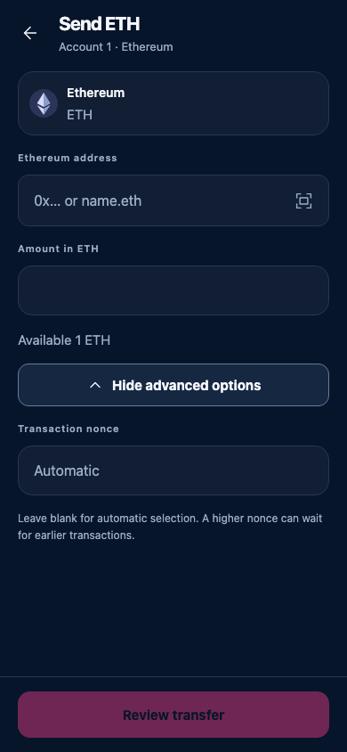

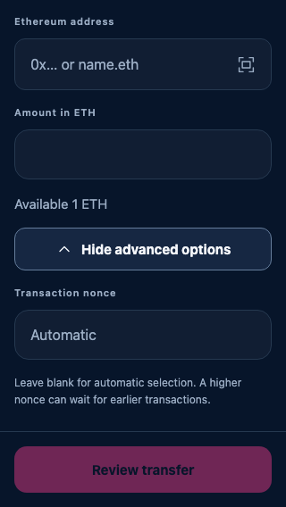

## 11-utxo-advanced — UTXO advanced transaction options

Component: NativeUtxoSend.

Route: http://127.0.0.1:4291/?utxo-send=1

Actions: Advanced options → Scroll to Replace-by-fee.

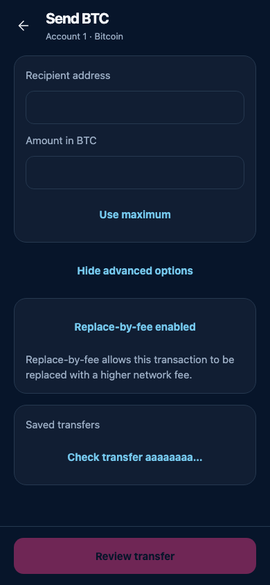

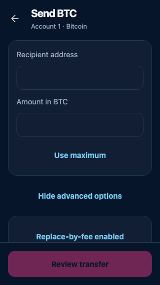

## 12-erc20-send — ERC-20 transfer form

Component: NativeSend.

Route: http://127.0.0.1:4291/?erc20-send=1

Actions: Initial state.

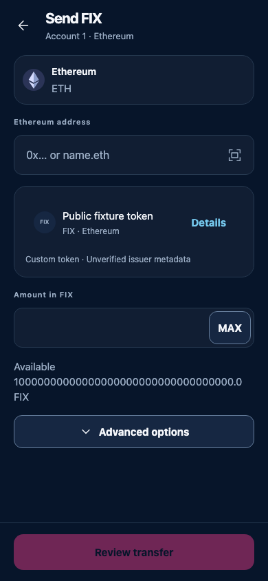

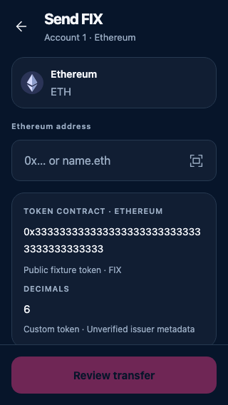

## 13-erc1155-send — ERC-1155 transfer form

Component: NativeSend.

Route: http://127.0.0.1:4291/?collectible=1155

Actions: Initial state.

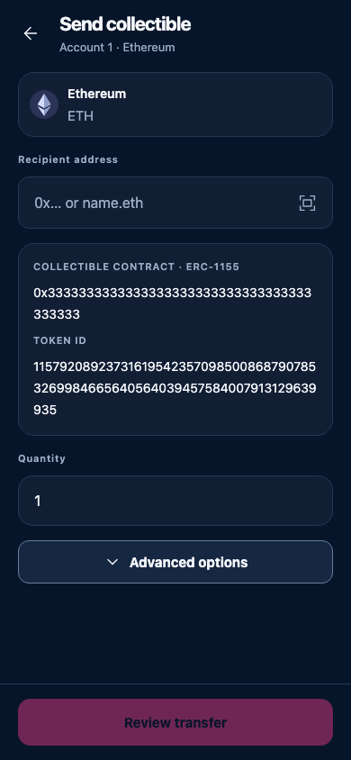

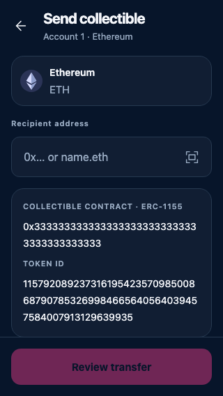

## 14-guardian-policy — Guardian policy and status

Component: NativeGuardianPolicy.

Route: http://127.0.0.1:4291/?guardian-policy=1

Actions: Check status.

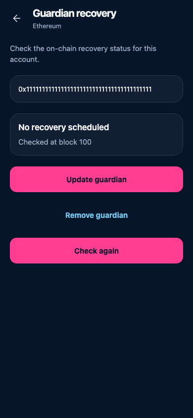

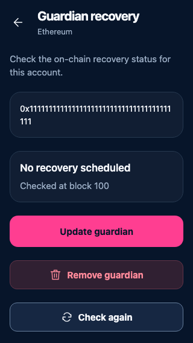

## 15-guardian-policy-edit — Guardian policy editor

Component: NativeGuardianPolicy.

Route: http://127.0.0.1:4291/?guardian-policy=1&new-policy

Actions: Check status → Set guardian.

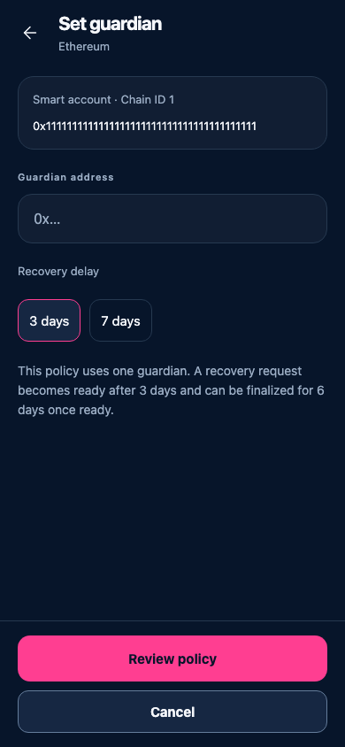

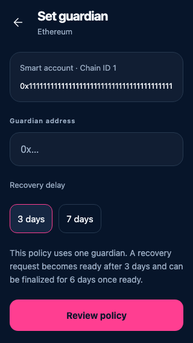

## 16-smart-guardian-recovery — Smart guardian / separate payer recovery

Component: NativeGuardianRecovery.

Route: http://127.0.0.1:4291/?guardian-recovery=1&smart-guardian=1

Actions: Initial state.

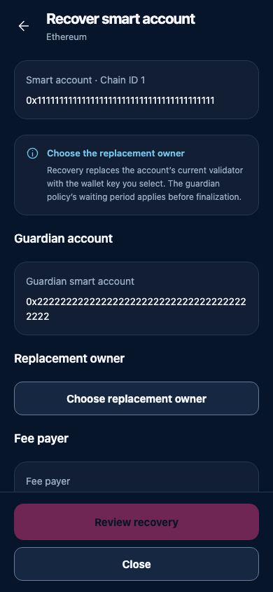

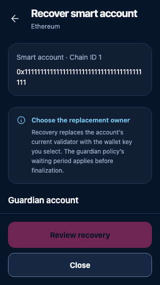

## 17-guardian-recovery-review — Guardian recovery proof review

Component: NativeGuardianRecovery.

Route: http://127.0.0.1:4291/?guardian-recovery=1&smart-guardian=1

Actions: Choose replacement owner → Replacement key → Review recovery.

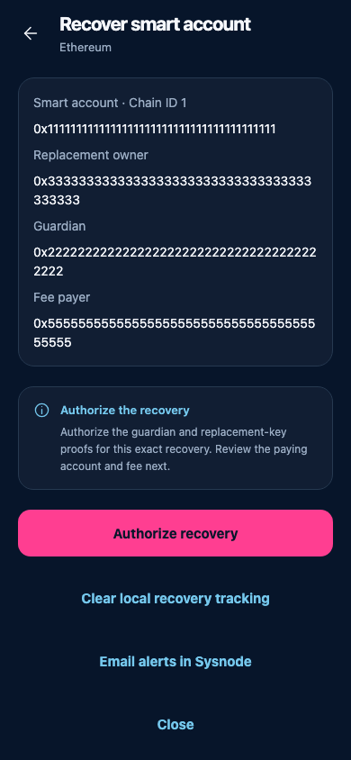

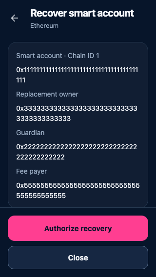

## 18-slh-keys — SLH-DSA prepared keys

Component: NativeSlhDsaManagement.

Route: http://127.0.0.1:4292/?slh-fixture=ready

Actions: Initial state.

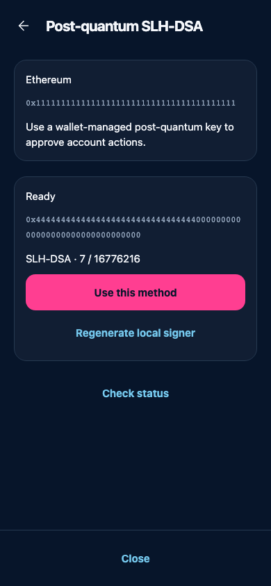

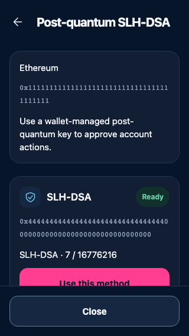

## 19-slh-installed — SLH-DSA installed keys

Component: NativeSlhDsaManagement.

Route: http://127.0.0.1:4292/?slh-fixture=installed

Actions: Initial state.

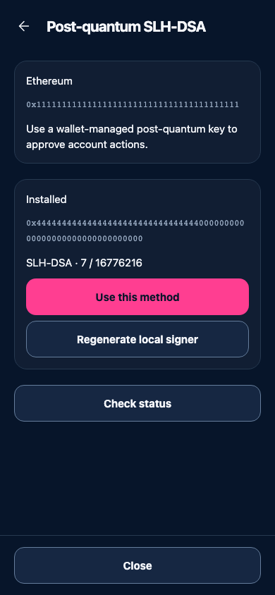

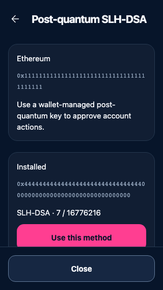

## 20-smart-transfer — Smart account transfer

Component: NativeSmartAccountSend.

Route: http://127.0.0.1:4291/?smart-currency=1

Actions: Initial state.

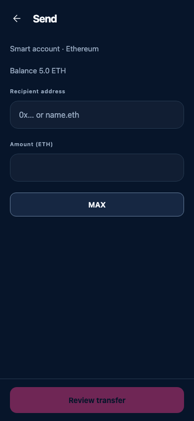

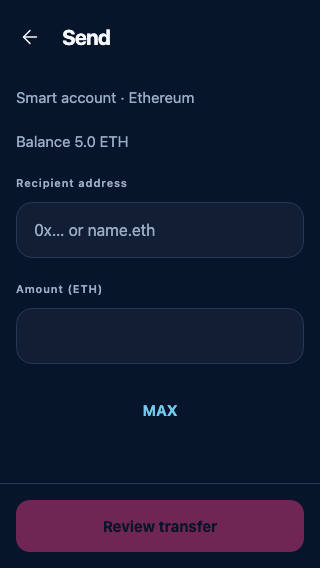

## 21-smart-deployment — Smart account deployment authorization

Component: NativeSmartAccountOperation.

Route: http://127.0.0.1:4291/?smart-deployment=1

Actions: Initial state.

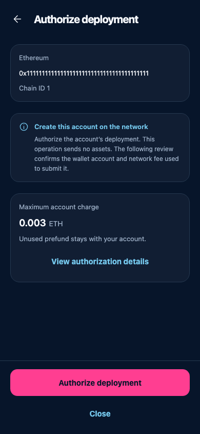

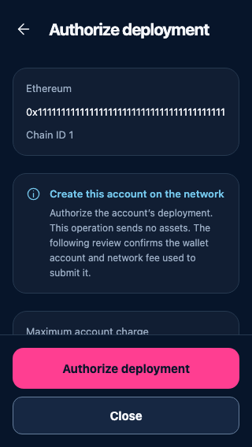

## 22-smart-batch — Smart account batched calls

Component: NativeSmartTransactionReview.

Route: http://127.0.0.1:4291/?smart-batch=1

Actions: Initial state.

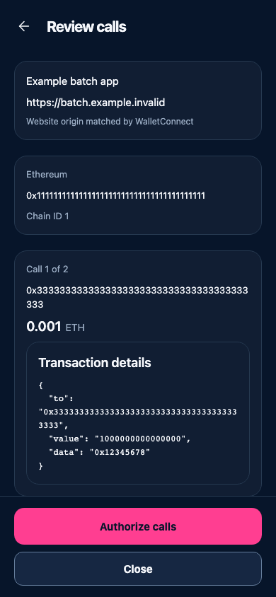

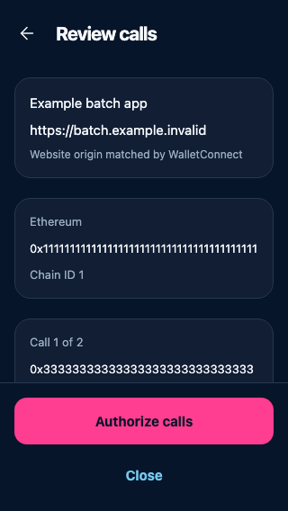

## 23-eoa-batch — Software account batched calls

Component: NativeTransactionReview.

Route: http://127.0.0.1:4291/?eoa-batch=1

Actions: Initial state.

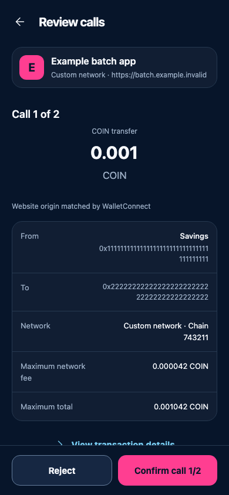

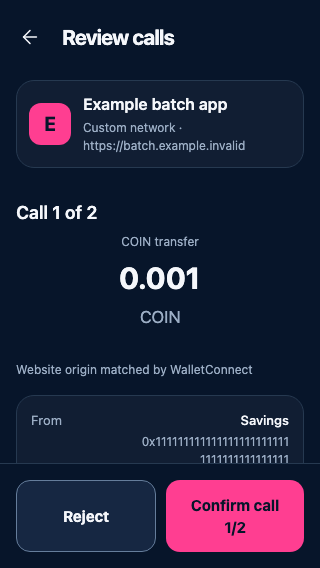

## 24-private-deposit — Private deposit form

Component: NativePrivateDeposit.

Route: http://127.0.0.1:4291/?private-deposit=1

Actions: Initial state.

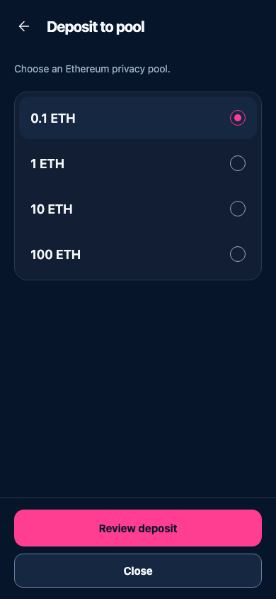

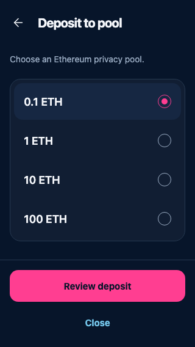

## 25-private-deposit-review — Private deposit review

Component: NativePrivateDeposit.

Route: http://127.0.0.1:4291/?private-deposit=1

Actions: Review deposit.

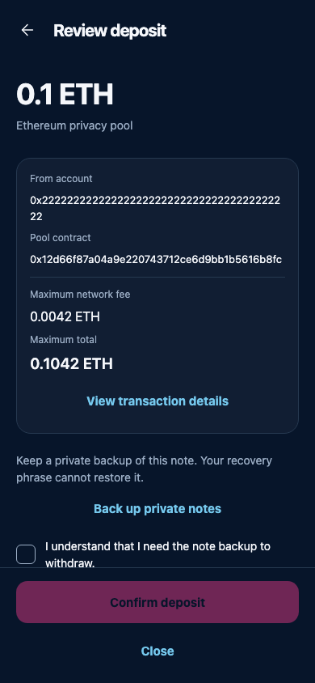

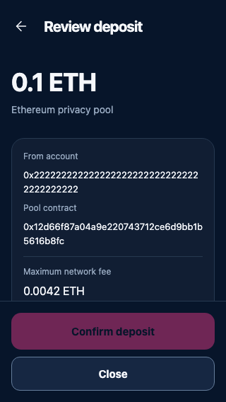

## 26-private-notes — Private note inventory

Component: NativeNoteInventory.

Route: http://127.0.0.1:4291/?private-withdrawal=1

Actions: Initial state.

## 27-private-withdrawal — Private withdrawal form

Component: NativePrivateWithdrawal.

Route: http://127.0.0.1:4291/?private-withdrawal=1

Actions: Select 1 ETH pool → Check pool status → Withdraw.

## 28-import-note — Import private note

Component: NativeNoteImport.

Route: http://127.0.0.1:4291/?note-import=1

Actions: Initial state.

## 29-sentry-keys — Sentry key management

Component: NativeSentryKeys.

Route: http://127.0.0.1:4291/?sentry=1

Actions: Initial state.

## 30-sentry-service — Sentry service settings

Component: NativeSentrySettings.

Route: http://127.0.0.1:4291/?sentry=1

Actions: Service settings.

## 31-sentry-nodes — Sentry nodes

Component: NativeSentryNodes.

Route: http://127.0.0.1:4291/?sentry-nodes=1

Actions: Initial state.

## 32-sentry-consent — Sentry request approval

Component: NativeSentryReview.

Route: http://127.0.0.1:4291/?sentry-consent=1

Actions: Initial state.

## 33-ledger-connect — Ledger discovery

Component: NativeLedger.

Route: http://127.0.0.1:4291/?ledger=1

Actions: Find Ledger.

## 34-ledger-account — Ledger account review

Component: NativeLedger.

Route: http://127.0.0.1:4291/?ledger=1

Actions: Find Ledger → My Ledger · Nano X.

## 35-trezor-import — Trezor account import

Component: NativeTrezor.

Route: http://127.0.0.1:4291/?trezor=1

Actions: Initial state.

## 36-trezor-smart-resume — Trezor Smart owner continuation

Component: NativeTrezorResumeNotice.

Route: http://127.0.0.1:4291/?trezor=1&resume=smart

Actions: Initial state.

Actual resume notice only; Continue is not invoked because this fixture transitions to placeholder review copy.

## 37-message-signature — Message signature review

Component: NativeMessageReview.

Route: http://127.0.0.1:4291/?message-review=1

Actions: Initial state.

## 38-dapp-network-request — Dapp network-change approval

Component: NativeDappControlReview.

Route: http://127.0.0.1:4291/?control-consent=1

Actions: Initial state.

## 39-auto-lock — Auto-lock preferences

Component: AutoLockSettings.

Route: http://127.0.0.1:4292/?visual-review=1

Actions: Unlock synthetic wallet → Settings → Security & backups → Auto-lock.

## 40-biometric-settings — Biometric enrollment settings

Component: NativeWallet.native (device-unlock stage).

Route: http://127.0.0.1:4292/?visual-review=1

Actions: Unlock synthetic wallet → Settings → Security & backups → Biometric unlock.

## 41-import-private-key — Import software private key

Component: NativeImport.

Route: http://127.0.0.1:4292/?visual-review=1

Actions: Unlock synthetic wallet → Accounts → Manage wallet accounts → Add account → Import private key.

## 42-display-currency — Display currency preferences

Component: DisplayCurrency.

Route: http://127.0.0.1:4292/?visual-review=1

Actions: Unlock synthetic wallet → Settings → Display currency.

## 43-languages — Language preferences

Component: NativePreferences.

Route: http://127.0.0.1:4292/?visual-review=1

Actions: Unlock synthetic wallet → Settings → Languages.

## 44-help-about — Help and about

Component: HelpAbout.

Route: http://127.0.0.1:4292/?visual-review=1

Actions: Unlock synthetic wallet → Settings → Help & about.

## 45-private-key-auth — Private-key reveal authorization

Component: NativeSecurity.

Route: http://127.0.0.1:4292/?visual-review=1

Actions: Unlock synthetic wallet → Settings → Security & backups → Reveal account private key.

## 46-watch-address-form — Add public watch account

Component: Onboarding / AddWatchAccount.

Route: http://127.0.0.1:4292/?evm-activity=1&evm-activity-mode=value

Actions: Accounts → Watch an account.

## 47-watch-utxo-key — Watch UTXO address, public key or descriptor

Component: Onboarding / AddWatchAccount.

Route: http://127.0.0.1:4292/?evm-activity=1&evm-activity-mode=value

Actions: Accounts → Watch an account → Bitcoin network → Scroll to public identifier.

## 48-asset-details — Native coin details

Component: NativePortfolio (native-asset view) / AssetMarketCard.

Route: http://127.0.0.1:4291/?network-portfolio=1

Actions: ETH Ethereum.

The existing fixture has no successful market-history provider; the actual unavailable state is shown. No chart data was invented.

## 49-backup-required-home — Wallet with backup still required

Component: NativePortfolio / WalletBackupBadge.

Route: http://127.0.0.1:4292/?visual-review=1&backup-required=1

Actions: Unlock synthetic wallet with unconfirmed backup.

## 50-synthetic-market-chart — Healthy market chart — synthetic data

Component: NativePortfolio / AssetMarketCard.

Route: http://127.0.0.1:4291/?network-portfolio=1

Actions: Intercept only quote/market responses with synthetic test data → ETH Ethereum → Wait for real chart → Scroll market card into view.

Explicitly synthetic CoinGecko-shaped data from the tests/assetMarket.test.ts contract: 2,200 USD, -1.2%, 2,100/2,300 low/high, 250 billion USD cap, four seven-day samples. No remote market data was fetched.

## 51-smart-modules — Installed Smart account modules

Component: NativeSmartAccountModules.

Route: http://127.0.0.1:4291/?smart-modules=1

Actions: Initial state.

## 52-custom-validator-consent — Custom validator risk review

Component: NativeSmartAccountModules / NativeSmartAccountOperationContent.

Route: http://127.0.0.1:4291/?smart-modules=1

Actions: Custom validator → Enter synthetic module address and name → Check module → Install (opens review only) → Scroll to real risk acknowledgement; leave it off.

## 53-composite-approvals — Combined approval policy editor

Component: NativeSmartAccountModules.

Route: http://127.0.0.1:4291/?smart-modules=1

Actions: Combined approvals.

## 54-wallet-authenticator — Use Pali wallet — authenticator change

Component: NativeSmartAccountAuthenticator / NativeSmartAccountOperationContent.

Route: http://127.0.0.1:4291/?smart-authenticator=1

Actions: Initial state.

## 55-smart-creation-consent — Configured Smart account creation consent

Component: NativeSmartPreparationReview.

Route: http://127.0.0.1:4291/?smart-preparation=1&preparation-mode=configured

Actions: Show requested external owners; acknowledgement remains off.

## 56-infrastructure-status — Smart account infrastructure status

Component: NativeInfrastructure.

Route: http://127.0.0.1:4291/?smart-infrastructure=1

Actions: Initial state.

## 57-infrastructure-fee — Smart infrastructure deployment fee review

Component: NativeInfrastructure.

Route: http://127.0.0.1:4291/?smart-infrastructure=1

Actions: Review setup fee.

## 58-biometric-transaction-auth — Biometric-enabled transaction review

Component: NativeSend.

Route: http://127.0.0.1:4291/?biometric-auth=1

Actions: Enter public recipient and 0.001 ETH → Review transfer → Show biometric-enabled Confirm and send plus Use PIN instead.

Actual review configured for biometrics, with an explicit Use PIN instead alternative. No confirmation button is pressed: no OS prompt, biometric proof, signature or submission is performed.

## 59-backup-required-settings — Settings with backup still required

Component: RealSettings / WalletBackupBadge.

Route: http://127.0.0.1:4292/?visual-review=1&backup-required=1

Actions: Unlock synthetic wallet with unconfirmed backup → Settings.

## 60-backup-required-security — Security with unconfirmed backup

Component: NativeSecurity.

Route: http://127.0.0.1:4292/?visual-review=1&backup-required=1

Actions: Unlock synthetic wallet with unconfirmed backup → Settings → Security & backups.

## 61-change-pin-current — Change PIN — current PIN

Component: NativeWallet / PinEntryScreen.

Route: http://127.0.0.1:4292/?visual-review=1

Actions: Unlock synthetic wallet → Settings → Security & backups → Change PIN.

## 62-change-pin-create — Change PIN — choose new PIN

Component: NativeWallet / PinSetup.

Route: http://127.0.0.1:4292/?visual-review=1

Actions: Unlock synthetic wallet → Settings → Security & backups → Change PIN → Enter current synthetic PIN.

## 63-change-pin-confirm — Change PIN — confirm new PIN

Component: NativeWallet / PinSetup.

Route: http://127.0.0.1:4292/?visual-review=1

Actions: Unlock synthetic wallet → Settings → Security & backups → Change PIN → Enter current synthetic PIN → Enter new synthetic PIN; do not commit.

## 64-pin-transaction-auth — PIN transaction confirmation

Component: NativeSend / TransactionAuthentication / PinPad.

Route: http://127.0.0.1:4291/?

Actions: Enter public recipient and 0.001 ETH → Review transfer → Confirm opens real PIN authentication.

Actual PIN authentication UI only. No PIN is entered into this review, no signature or transaction submission is performed.

## 65-smart-send-form — Smart account send form

Component: NativeSmartAccountSend / SendNetworkCard.

Route: http://127.0.0.1:4291/?smart-currency=1

Actions: Initial state.

## Not represented

- **Hardware infrastructure payer continuation:** apps/mobile/src/screens/NativeInfrastructure.tsx is captured with a synthetic software payer. Ledger connection and Trezor Suite continuation for infrastructure are not represented by these new fixture routes.
- **Physical Ledger, Trezor, biometric, camera and OS keyboard states:** This gallery uses public synthetic adapters in RNWeb. Real device prompts, transport, camera and keyboard are not represented.

## Capture checks

- Page errors: 0
- Horizontal document overflow: 0
- Unrendered attempts: 0
