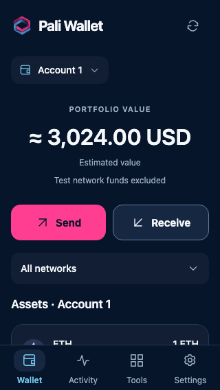
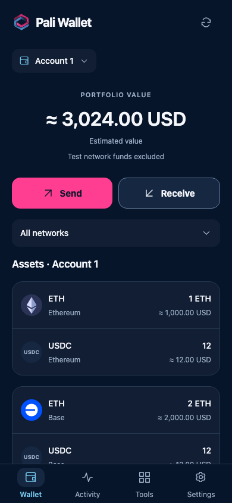
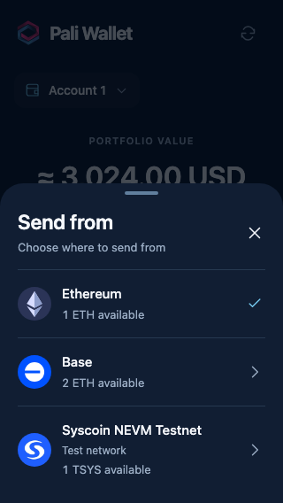
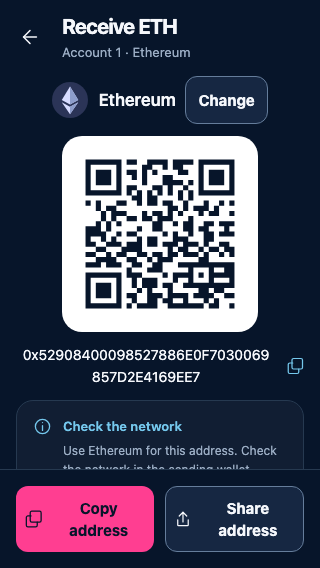
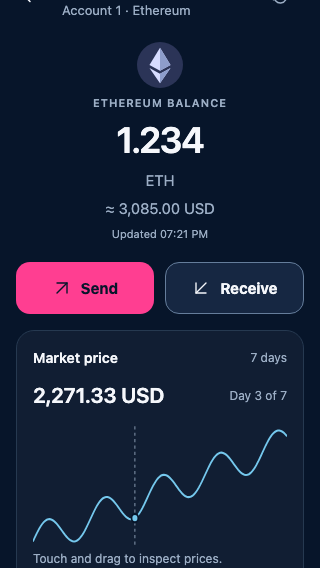
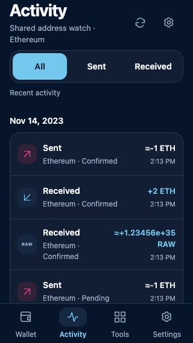
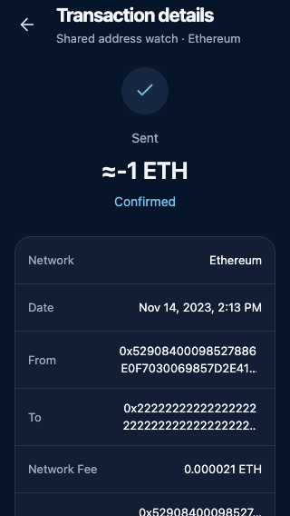
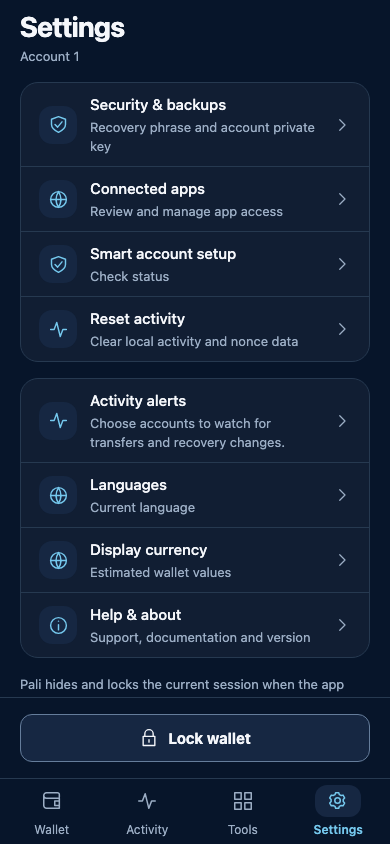
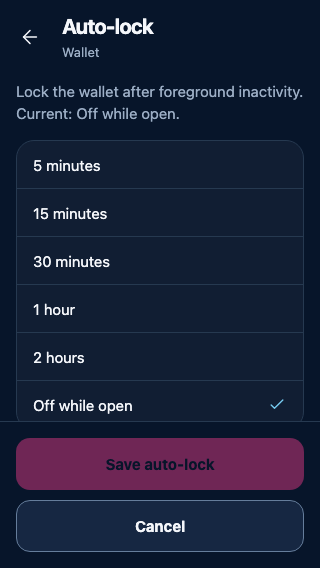
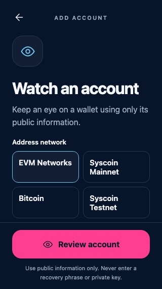

# Mobile polish pass — 12 November

Current React Native components rendered with synthetic public data. These captures cover the revised portfolio, copy controls, chart, navigation and settings. The viewport may show only part of scrollable content. Native OS authorization, camera, hardware and physical gestures require separate qualification.

The source is `79061519f` plus the reviewed polish patch recorded in [the capture manifest](manifest.json). The later amount-validation grammar correction and amber Smart-account address warning are not represented in these frames.

| Screen | 320px | Wider view |
| --- | --- | --- |
| All-networks home |  |  |
| Send from |  | |
| Receive, full copyable address |  | |
| Selected chart price |  | |
| Activity |  | |
| Transaction detail |  | |
| Settings | |  |
| Auto-lock, default Off |  | |
| Watch-account setup |  | |

The Receive fix passed eight existing viewport/large-text cases plus a regression that checks actual text bounds, copy-icon visibility and exact clipboard contents. The chart's selected point was exercised through its native callback in the browser, using a deterministic market-data response; this does not establish live provider availability or a physical touch pass.
