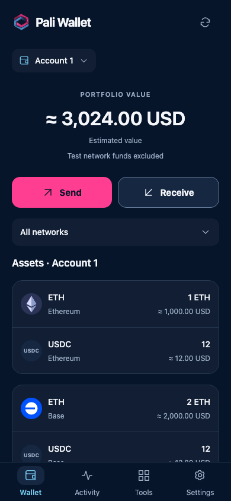
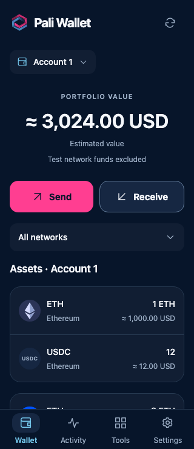
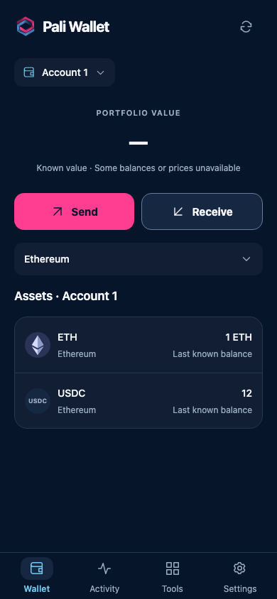
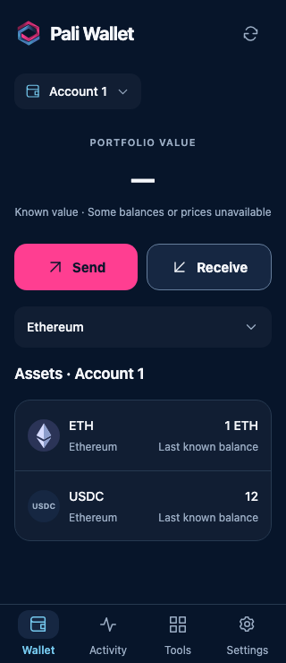
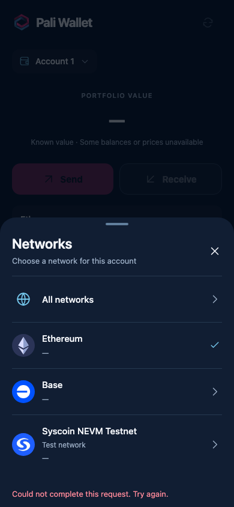
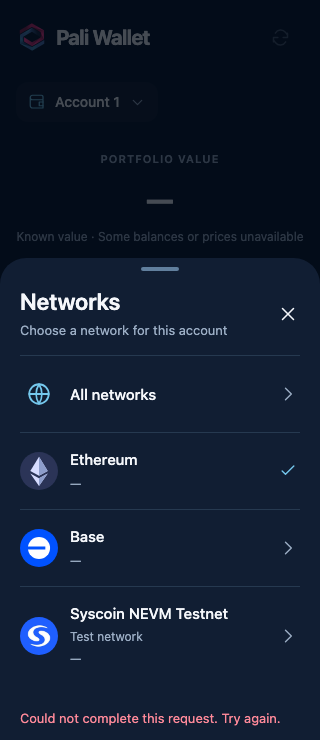
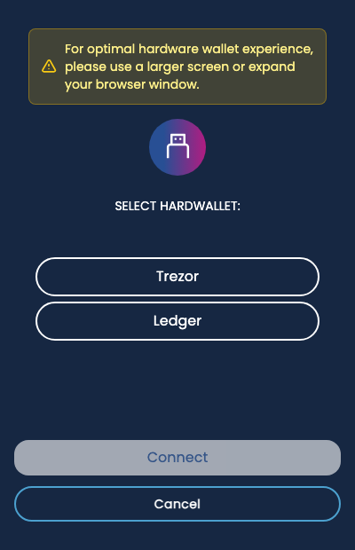
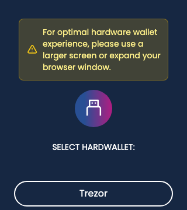
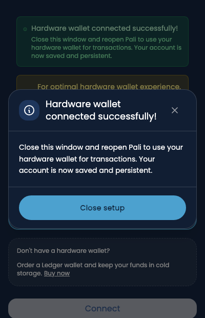
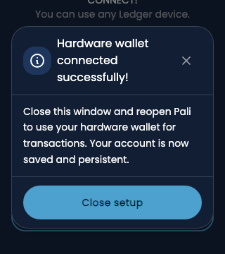

# Wallet quality pass

Source: `e5a1751b6a0903f3cce40245f19e83b155b20191`. [Frame provenance](manifest.json).

These are actual rendered components with synthetic public data. They do not prove native biometric, camera, physical hardware, or funded transaction behavior.

The pass reviewed onboarding and recovery, PIN/biometric entry, backup, portfolio and activity, native/token/NFT transfers, settings, dapp consent and connections, smart accounts and guardians, private notes, Sentry, hardware setup, and the shared SDK authorization boundaries. It found no additional validated custody defect. The focused changes below address confirmed product and performance problems.

- Balance and asset rows publish before optional prices. Two price workers share an eight-second total budget; failed prices do not mark balances failed.
- Failed observations retain exact cached units, show “Last known balance,” and omit stale fiat. Unknown balances say “Balance unavailable.”
- Network selection errors remain visible inside the open sheet; reopening a sheet clears unrelated previous errors.
- Hardware setup allows changing an idle device selection, announces waiting status, preserves accessible button labels, and uses one dismissible completion dialog.
- Advanced settings retain visible keyboard focus. CoinGecko listing is described as market-data provenance, without implying a security verification.

Validation: 28 mobile controller/component tests, 68 extension tests, eight browser portfolio journeys, mobile and extension typechecks, focused lint and localization checks. Separate independent source reviews covered the changes. Extension fixture checks include keyboard focus, dialog dismissal, waiting state and short-window visibility. Shared SDK adoption fixtures add 292 passing tests in the preceding commit.

## Mobile — healthy overview

| 390 px | 320 px |
| --- | --- |
|  |  |

## Mobile — cached data after a failed refresh

| 390 px | 320 px |
| --- | --- |
|  |  |

## Mobile — retryable selection failure

| 390 px | 320 px |
| --- | --- |
|  |  |

## Extension — hardware setup and completion

| Ordinary window | Short window |
| --- | --- |
|  |  |
|  |  |

## Second independent pass

The follow-up source review rechecked shared button callers, hardware focus and dismissal, portfolio ownership/cancellation/work limits, and mobile onboarding/recovery/send/settings/advanced flows. It found one additional product defect: after a failed PIN-only setup submission, the confirmation keypad could remain sealed. The correction opens a fresh confirmation attempt and retires the old callback, retaining duplicate-submission protection. Two regressions cover delayed and immediate failures; all 76 related PIN/recovery tests pass. Mobile typecheck and targeted lint pass. This changes retry state only, not credential storage or authorization policy.

## Authentication error feedback

PIN errors and the app's biometric-failure fallback now shake the dot indicator horizontally by at most 6 px for 300 ms; buttons stay still. The completed PIN string clears before submission, while only the filled-dot count remains briefly. Reduce Motion keeps the indicator static and clears immediately. Backgrounding, Android blur, a new input, or unmount cancels the animation. Native Face ID/fingerprint dialogs retain OS-controlled feedback.

## Third independent pass

Returning from system Settings now refreshes camera permission without another permission prompt, so both recipient and WalletConnect scanners recover after access is granted. Scanning stays disabled during the refresh, and callbacks from the previous camera instance cannot affect the resumed view. Focused tests cover iOS/Android lifecycle sequences, initial-prompt races, permission changes, and stale callbacks; physical OS Settings verification remains separate.

Explorer-discovered NFTs now retain their shared token ID and quantity in mobile Activity and details, matching the extension's interpretation. Regressions cover ERC-721 ID `0` and an ERC-1155 maximum-size ID/quantity. The two fixes pass 40 focused tests, mobile typechecking, targeted lint, and independent review. No shared SDK or authorization-policy change is needed.
