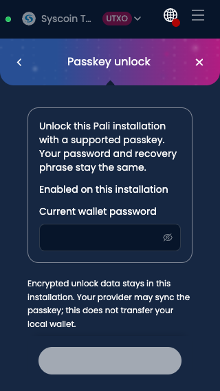
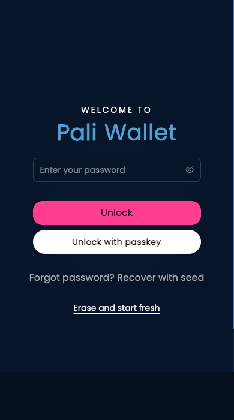

# Local passkey unlock review

Source: `bcc7d3d9ea06fc9deadaff195138ebd7e2838726`.

These are actual production-extension renders from the offline local-passkey journey. The disposable public test wallet uses a Chromium virtual CTAP2.1 authenticator with PRF; it is not a physical authenticator or device qualification. The journey passed enrollment, same-wallet unlock, removal, and password fallback. No transaction was submitted.

## Settings at 320 pixels

## Unlock

The existing session-based extension unlock model is unchanged. Enrollment requires the current password; passkey assertions require user verification and a matching PRF-wrapped local key. Unsupported browsers/providers keep password unlock.
